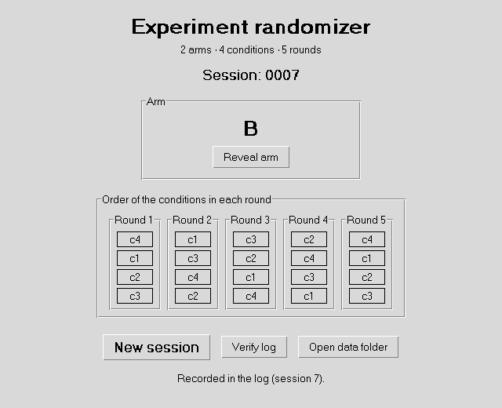

# experiment-randomizer

[](https://github.com/juanbezerra1/experiment-randomizer/actions/workflows/ci.yml)


*Leia em português: [README.pt-BR.md](README.pt-BR.md)*

**Reproducible, auditable randomisation for small experiments: who gets which arm, in which
order the conditions are run, and a log that notices if anyone edits it.**

The randomiser every lab ends up writing is usually a `random.shuffle` in a script and a
spreadsheet of results. It works until someone asks to *see* the allocation again (no seed was
kept), until the arms come out 14-6 in a 20-participant study (coin tossing does that), until two
windows are open at once (two participants get session number 8), or until a cell is corrected by
hand and nobody can say when. This project fixes each of those, with the standard library only.

| | |
|---|---|
| `Protocol`, `draw` | everything that decides an allocation (arms, ratio, conditions, rounds, design, seed) in one small JSON file; `draw(protocol, k)` is a pure function, so any session can be regenerated and compared with the log |
| `permuted_blocks` | arm allocation in permuted blocks of random size, any ratio (`2:1`, three arms...): the imbalance can never exceed half the largest block |
| `block_orders` | the order of the conditions in each round: independent shuffles, a cyclic Latin square (balances position) or a Williams design (also balances carry-over) |
| `Study` | a folder with the protocol and a log; `next()` writes the session to disk *before* returning it |
| hash-chained log | every row carries a SHA-256 of the row before it, starting from the protocol; `exprand verify` finds edited, deleted, inserted and reordered rows |
| `FileLock` | an operating-system lock, so two programs cannot draw the same session; it disappears with the process, so a crash never leaves a stale lock |
| `exprand` command, `exprand gui` | a command line and a small window (English, Portuguese and Spanish) on top of the same code |



## Try it

```bash
pip install git+https://github.com/juanbezerra1/experiment-randomizer.git
exprand init --dir study --arms A,B --conditions c1,c2,c3,c4 --rounds 3 --design williams
exprand next --dir study --note "pilot 1"
exprand annotate --dir study 1 "did not attend"
exprand verify --dir study
exprand gui --dir study
```

`init` writes `study/study.json` (the protocol, with its seed) and prints the protocol hash.
`next` draws and logs one session:

```text
session 0001
arm      B
round 1  c1 c2 c4 c3
round 2  c2 c3 c1 c4
round 3  c3 c4 c2 c1
logged   (row hash 9d0d62c39d8c...)
```

`study/log.csv` is a plain `;`-separated file that a spreadsheet opens directly:

```text
kind;session;timestamp;arm;round_1;round_2;round_3;note;hash
draw;1;2026-11-22T12:13:04-03:00;B;c1-c2-c4-c3;c2-c3-c1-c4;c3-c4-c2-c1;pilot 1;9d0d62c3...
note;1;2026-11-22T12:13:41-03:00;;;;;did not attend;78ba8744...
```

A *round* is one pass through every condition. Sessions are never reused or deleted: a session
that was not run gets a note, so nobody can quietly draw again until the arm suits them. Nothing is
drawn until you ask: opening the window or running `exprand show` never spends a session number.

Other commands: `exprand show` lists the log, `exprand plan --dir study 20` prints the first 20
allocations without logging them (they are the ones `next` will deliver), and `exprand head` prints
the latest chain hash.

From Python, with the same files:

```python
import exprand as ex

protocol = ex.Protocol(
    arms=("A", "B"),  # who gets what: permuted blocks of 4 or 6
    conditions=("c1", "c2", "c3", "c4"),  # what each session runs
    n_rounds=3,  # passes through the conditions per session
    design="williams",  # shuffle | latin | williams
    seed=2024,  # omit for a random seed, stored in study.json
)
study = ex.Study.init("my_study", protocol)

allocation = study.next(note="pilot 1")  # written to the log, then returned
print(allocation.session, allocation.arm, allocation.round_strings())

study.annotate(1, "did not attend")  # a remark; rows are never edited or removed
report = study.verify()
print(report.ok, report.arm_counts, report.head[:12])

assert ex.draw(protocol, 1) == allocation  # regenerated from the protocol alone
```

## Why permuted blocks

Tossing a coin for each participant leaves small studies lopsided. `examples/imbalance.py`
simulates 20 000 studies of 20 participants and two arms:

| share of studies ending with a difference of at least | 4 (12-8) | 6 (13-7) | 8 (14-6) |
|---|---:|---:|---:|
| coin tossing, simulated | 50.5% | 26.6% | 11.7% |
| coin tossing, exact binomial | 50.3% | 26.3% | 11.5% |
| permuted blocks of 4 and 6 | 0% | 0% | 0% |

The largest difference seen was 16 with a coin and 2 with permuted blocks. Blocks have random
sizes so that, even when someone knows the scheme, the last assignment of a block is not certain.
Nothing is balanced for free: with a fixed seed the whole sequence is determined, which is why the
protocol file should stay away from whoever enrols participants if concealment matters (see below).

## How the log protects itself

Each row stores `SHA-256(previous hash + the row's fields)`, and the first row chains to the hash
of the protocol. Then:

* editing a cell, deleting, inserting, duplicating or reordering rows, or changing `study.json`
  after the first session breaks the chain from that point on;
* a forger who recomputes every hash is still caught, because `verify` *regenerates* each arm and
  order from the protocol and seed and compares them with the file;
* `next` and `annotate` refuse to add to a log that fails verification, so a damaged file is never
  quietly extended (a script that treats a read error as "no sessions yet" restarts numbering at 1).

Two things the chain cannot do, and the tests say so (`tests/test_study.py`):

* **Cutting off the latest sessions leaves a valid, shorter log.** Write down `exprand head` now
  and then (a lab notebook, an e-mail to a colleague) and run
  `exprand verify --expect-head <hash>` later: that catches truncation.
* **Someone who rewrites the protocol and recomputes the whole chain** produces a log that is
  consistent with itself. The same written-down head catches that too.

This is tamper-*evidence* for accidents and casual edits, not a signature scheme: there is no secret
key, so a determined person with write access and no external record can forge everything.

## Design decisions and honest limits

* **Reproducible on any Python.** The streams are built on `random.Random.random()` only, whose
  output the standard library guarantees; `shuffle` and `randrange` are not guaranteed to keep
  their algorithms. Known-answer tests pin the sequences, and CI runs them on Python 3.10-3.13 on
  Linux and on the oldest and newest Python on Windows and macOS.
* **Latin and Williams orders** balance position exactly within a session only when the number of
  rounds is a multiple of the number of rows (`n` conditions, or `2n` for a Williams design with an
  odd `n`); otherwise they balance in expectation across sessions. With four conditions the cyclic
  designs have just 24 distinct session patterns, whereas `shuffle` has `24^rounds`.
* **No allocation concealment.** The seed is in `study.json`: whoever can read it can predict every
  session. That is right for one experimenter who wants an auditable record; for a blinded study
  keep the protocol with a third party and give the enrolling person only `exprand next`.
* **Local disks only.** The lock is an operating-system file lock, reliable on a local drive but
  not on every network share, and a synced folder (Dropbox, OneDrive) can create conflicted copies
  of the log. Draw on a local folder and copy the result.
* **Do not re-save the log from a spreadsheet.** Opening it is fine. Saving can rewrite
  timestamps and cells such as `1-2-3` as dates, and `verify` will then (correctly) complain.
* **Participant codes only.** The log has a free-text `note`; never put names or other identifiers
  in it, and do not commit a real study folder to a public repository: it holds the seed and every
  allocation.
* **Not a clinical-trial system.** No stratification, minimisation, or central randomisation
  service; for those use a dedicated tool (the R packages `blockrand` and `randomizr`, or the
  randomisation module of REDCap).

More detail, with the exact hash definition and file format: [`docs/design.md`](docs/design.md).

## Development

```bash
pip install -e ".[dev]"
pytest                                   # 300+ tests, including four programs drawing at once
EXPRAND_GUI_TESTS=1 xvfb-run -a pytest tests/test_gui.py   # the window, on a virtual display
ruff check . && ruff format --check . && mypy src
```

CI runs the tests on Python 3.10-3.13 (Linux) and on Python 3.10 and 3.13 (Windows, macOS), the
window under `xvfb`, lint and types, and installs the built wheel in a clean environment.

## Related

Part of a small toolbox for experiments with biosignals:
[`biosigkit`](https://github.com/juanbezerra1/biosigkit) (EMG and force trials to feature tables),
[`eeg-erds`](https://github.com/juanbezerra1/eeg-erds) (ERD/ERS, ERP and blink removal) and
[`subjectwise`](https://github.com/juanbezerra1/subjectwise-ml) (honest validation with few subjects).

## License

MIT, see [LICENSE](LICENSE).
