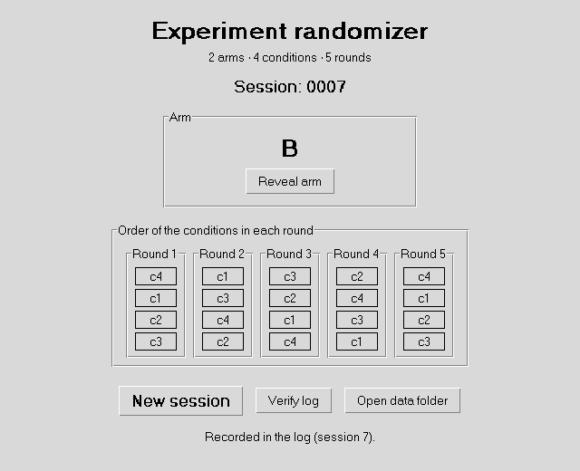

# experiment-randomizer

[](https://github.com/juanbezerra1/experiment-randomizer/actions/workflows/ci.yml)


*Read in English: [README.md](README.md)*

**Randomização reproduzível e auditável para experimentos pequenos: quem vai para qual braço, em
que ordem as condições são executadas, e um registro que percebe se alguém o editar.**

O sorteador que todo laboratório acaba escrevendo costuma ser um `random.shuffle` num script e uma
planilha de resultados. Funciona até alguém pedir para *ver* o sorteio de novo (ninguém guardou a
semente), até os braços saírem 14 a 6 num estudo de 20 participantes (jogar moeda faz isso), até
duas janelas ficarem abertas ao mesmo tempo (dois participantes recebem a sessão 8) ou até uma
célula ser corrigida à mão sem que ninguém saiba quando. Este projeto resolve cada um desses
problemas usando só a biblioteca padrão.

| | |
|---|---|
| `Protocol`, `draw` | tudo que decide um sorteio (braços, proporção, condições, rodadas, desenho, semente) num arquivo JSON pequeno; `draw(protocol, k)` é uma função pura, então qualquer sessão pode ser regenerada e comparada com o registro |
| `permuted_blocks` | alocação de braços em blocos permutados de tamanho aleatório, com qualquer proporção (`2:1`, três braços...): o desbalanceamento nunca passa de metade do maior bloco |
| `block_orders` | a ordem das condições em cada rodada: embaralhamentos independentes, quadrado latino cíclico (equilibra a posição) ou desenho de Williams (equilibra também o efeito residual da condição anterior) |
| `Study` | uma pasta com o protocolo e um registro; `next()` grava a sessão no disco *antes* de devolvê-la |
| registro encadeado por hash | cada linha traz o SHA-256 da linha anterior, começando pelo protocolo; `exprand verify` acha linhas editadas, apagadas, inseridas e reordenadas |
| `FileLock` | um bloqueio do sistema operacional, para que dois programas não sorteiem a mesma sessão; ele some junto com o processo, então uma queda nunca deixa um bloqueio velho para trás |
| comando `exprand`, `exprand gui` | uma linha de comando e uma janelinha (em inglês e português) sobre o mesmo código |



## Experimente

```bash
pip install git+https://github.com/juanbezerra1/experiment-randomizer.git
exprand init --dir estudo --arms A,B --conditions c1,c2,c3,c4 --rounds 3 --design williams
exprand next --dir estudo --note "piloto 1"
exprand annotate --dir estudo 1 "não compareceu"
exprand verify --dir estudo
exprand gui --dir estudo --lang pt
```

O `init` grava `estudo/study.json` (o protocolo, com a semente) e imprime o hash do protocolo.
O `next` sorteia e registra uma sessão:

```text
session 0001
arm      B
round 1  c1 c2 c4 c3
round 2  c2 c3 c1 c4
round 3  c3 c4 c2 c1
logged   (row hash 9d0d62c39d8c...)
```

O `estudo/log.csv` é um arquivo simples separado por `;` que a planilha abre direto:

```text
kind;session;timestamp;arm;round_1;round_2;round_3;note;hash
draw;1;2026-11-22T12:13:04-03:00;B;c1-c2-c4-c3;c2-c3-c1-c4;c3-c4-c2-c1;piloto 1;9d0d62c3...
note;1;2026-11-22T12:13:41-03:00;;;;;não compareceu;78ba8744...
```

Uma *rodada* é uma passagem por todas as condições. Sessões nunca são reaproveitadas nem apagadas:
uma sessão que não foi realizada ganha uma nota, para ninguém sortear de novo até o braço agradar.
Nada é sorteado até você pedir: abrir a janela ou rodar `exprand show` nunca gasta um número de
sessão.

Outros comandos: `exprand show` lista o registro, `exprand plan --dir estudo 20` imprime os 20
primeiros sorteios sem registrá-los (são os que o `next` vai entregar) e `exprand head` imprime o
último hash da cadeia.

Pelo Python, com os mesmos arquivos:

```python
import exprand as ex

protocol = ex.Protocol(
    arms=("A", "B"),  # quem recebe o quê: blocos permutados de 4 ou 6
    conditions=("c1", "c2", "c3", "c4"),  # o que cada sessão executa
    n_rounds=3,  # passagens pelas condições em cada sessão
    design="williams",  # shuffle | latin | williams
    seed=2024,  # sem isso a semente é aleatória e fica em study.json
)
study = ex.Study.init("meu_estudo", protocol)

allocation = study.next(note="piloto 1")  # gravada no registro, depois devolvida
print(allocation.session, allocation.arm, allocation.round_strings())

study.annotate(1, "não compareceu")  # uma observação; linhas nunca são editadas nem removidas
report = study.verify()
print(report.ok, report.arm_counts, report.head[:12])

assert ex.draw(protocol, 1) == allocation  # regenerada só a partir do protocolo
```

## Por que blocos permutados

Jogar uma moeda para cada participante deixa estudos pequenos desequilibrados.
`examples/imbalance.py` simula 20 000 estudos de 20 participantes e dois braços:

| fatia dos estudos que terminam com diferença de pelo menos | 4 (12-8) | 6 (13-7) | 8 (14-6) |
|---|---:|---:|---:|
| moeda, simulado | 50,5% | 26,6% | 11,7% |
| moeda, binomial exata | 50,3% | 26,3% | 11,5% |
| blocos permutados de 4 e 6 | 0% | 0% | 0% |

A maior diferença vista foi 16 com a moeda e 2 com blocos permutados. Os blocos têm tamanhos
aleatórios para que, mesmo quem conhece o esquema, não tenha certeza da última atribuição de um
bloco. Nada disso é de graça: com a semente fixa a sequência inteira fica determinada, e por isso o
arquivo de protocolo deve ficar longe de quem recruta os participantes quando o sigilo importa
(veja abaixo).

## Como o registro se protege

Cada linha guarda `SHA-256(hash anterior + os campos da linha)`, e a primeira linha se encadeia ao
hash do protocolo. Então:

* editar uma célula, apagar, inserir, duplicar ou reordenar linhas, ou mudar o `study.json` depois
  da primeira sessão, quebra a cadeia daquele ponto em diante;
* quem recalcular todos os hashes ainda é pego, porque o `verify` *regenera* cada braço e cada
  ordem a partir do protocolo e da semente e compara com o arquivo;
* `next` e `annotate` se recusam a acrescentar a um registro que falha na verificação, então um
  arquivo danificado nunca é prolongado em silêncio (um script que trata erro de leitura como
  "nenhuma sessão ainda" recomeça a numeração do 1).

Duas coisas que a cadeia não consegue, e os testes dizem isso (`tests/test_study.py`):

* **Cortar as últimas sessões deixa um registro válido, só que mais curto.** Anote o `exprand head`
  de vez em quando (caderno de laboratório, e-mail para um colega) e rode depois
  `exprand verify --expect-head <hash>`: isso pega o truncamento.
* **Quem reescreve o protocolo e recalcula a cadeia inteira** produz um registro coerente consigo
  mesmo. O mesmo hash anotado pega isso também.

Isto é *evidência* de adulteração para acidentes e edições casuais, não um esquema de assinatura:
não há chave secreta, então uma pessoa determinada, com acesso de escrita e sem registro externo,
consegue forjar tudo.

## Decisões de projeto e limites honestos

* **Reproduzível em qualquer Python.** Os fluxos usam só `random.Random.random()`, cuja saída a
  biblioteca padrão garante; `shuffle` e `randrange` não têm garantia de manter o algoritmo. Testes
  com respostas conhecidas fixam as sequências, e o CI as roda no Python 3.10-3.13 (Linux) e nos
  Python mais antigo e mais novo no Windows e no macOS.
* **As ordens latina e de Williams** equilibram a posição exatamente dentro de uma sessão só quando
  o número de rodadas é múltiplo do número de linhas (`n` condições, ou `2n` num Williams com `n`
  ímpar); caso contrário equilibram em expectativa entre as sessões. Com quatro condições os
  desenhos cíclicos têm só 24 padrões de sessão distintos, enquanto o `shuffle` tem `24^rodadas`.
* **Sem sigilo de alocação.** A semente está no `study.json`: quem puder lê-lo prevê todas as
  sessões. Isso serve para um experimentador que quer um registro auditável; num estudo cego,
  deixe o protocolo com uma terceira pessoa e dê a quem recruta só o `exprand next`.
* **Só em disco local.** O bloqueio é um bloqueio de arquivo do sistema operacional, confiável em
  disco local mas não em qualquer pasta de rede, e uma pasta sincronizada (Dropbox, OneDrive) pode
  criar cópias em conflito do registro. Sorteie numa pasta local e copie o resultado. O
  `exprand init`, `next`, `annotate` e `gui` avisam (no stderr, e na janela como uma nota; nunca
  se recusam a sortear, e uma pasta local não recebe nada) quando a pasta é um compartilhamento ou
  uma unidade de rede do Windows, um ponto de montagem NFS ou SMB, ou uma pasta do OneDrive,
  Dropbox, Google Drive ou iCloud Drive. Outras ferramentas de sincronização não são reconhecidas,
  então a falta de aviso não significa que a pasta é segura. `EXPRAND_NO_LOCATION_WARNING=1`
  silencia o aviso.
* **Não salve o registro de novo pela planilha.** Abrir não tem problema. Salvar pode reescrever
  datas e células como `1-2-3` (que vira data), e o `verify` vai (com razão) reclamar.
* **Só códigos de participante.** O registro tem uma `note` de texto livre; nunca ponha nomes nem
  outros identificadores nela, e não suba uma pasta de estudo real para um repositório público: ela
  contém a semente e todos os sorteios.
* **Não é um sistema de ensaio clínico.** Não há estratificação, minimização nem serviço central de
  randomização; para isso use uma ferramenta dedicada (os pacotes de R `blockrand` e `randomizr`,
  ou o módulo de randomização do REDCap).

Mais detalhes, com a definição exata do hash e do formato do arquivo:
[`docs/design.md`](docs/design.md) (em inglês).

## Desenvolvimento

```bash
pip install -e ".[dev]"
pytest                                   # 300+ testes, incluindo quatro programas sorteando juntos
EXPRAND_GUI_TESTS=1 xvfb-run -a pytest tests/test_gui.py   # a janela, numa tela virtual
ruff check . && ruff format --check . && mypy src
```

O CI roda os testes no Python 3.10-3.13 (Linux) e nos Python 3.10 e 3.13 (Windows, macOS), a
janela sob `xvfb`, o lint e os tipos, e instala o wheel construído num ambiente limpo.

## Relacionados

Parte de um pequeno conjunto de ferramentas para experimentos com biossinais:
[`biosigkit`](https://github.com/juanbezerra1/biosigkit) (tentativas de EMG e força para tabelas de
features), [`eeg-erds`](https://github.com/juanbezerra1/eeg-erds) (ERD/ERS, ERP e remoção de
piscadas) e [`subjectwise`](https://github.com/juanbezerra1/subjectwise-ml) (validação honesta com
poucos sujeitos).

## Licença

MIT, veja [LICENSE](LICENSE).
